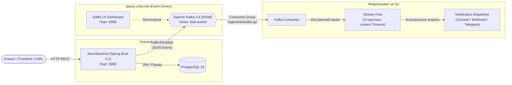

# Tasker Platform: Polyglot Event-Driven Architecture 🚀

Распределённая система управления задачами и асинхронных уведомлений, построенная на полиглотном стеке **Java (Spring Boot) + Go + Apache Kafka + PostgreSQL**.

---

## 🏗 Архитектура системы



---

## 🛠 Технологический стек

* **Бэкенд ядра (Java):** Java 21, Spring Boot 3.2, Spring Data JPA, Flyway, Hibernate, Jackson.
* **Микросервис уведомлений (Go):** Go 1.22+, `segmentio/kafka-go`, Worker Pool на горутинах и каналах, `context.Context` (таймауты и отмена), `sync.WaitGroup`, Graceful Shutdown.
* **Брокер сообщений:** Apache Kafka 3.8 в режиме KRaft (без Zookeeper), Kafka UI.
* **База данных:** PostgreSQL 16.
* **DevOps & CI/CD:** Docker, Docker Compose (Multi-stage сборка: Go-образ всего ~15 МБ), GitHub Actions CI.

---

## 📁 Структура монорепозитория

```text
.
├── .github/
│   └── workflows/
│       └── ci.yml               # GitHub Actions CI (проверка Java + Go + Docker)
├── backend-java/                # Основной бэкенд на Spring Boot
│   ├── src/                     # Исходный код Java
│   ├── pom.xml                  # Конфигурация Maven
│   └── Dockerfile               # Multi-stage сборка JVM приложения
├── notifier-go/                 # Микросервис на Go
│   ├── cmd/
│   │   └── notifier/main.go     # Точка входа сервиса
│   ├── internal/
│   │   ├── consumer/            # Чтение событий из Kafka
│   │   ├── event/               # DTO контракта событий (совместимо с Jackson)
│   │   └── notifier/            # Worker Pool для асинхронной обработки
│   ├── go.mod, go.sum           # Зависимости Go
│   └── Dockerfile               # Сверхлегковесный образ (~15 МБ)
├── docker-compose.yml           # Локальное окружение (Kafka, Postgres, Kafka UI)
├── .gitignore
└── README.md
```

---

## 🚀 Быстрый старт

### 1. Запуск инфраструктуры (Kafka + PostgreSQL + Kafka UI)
```bash
docker compose up -d
```
* **Kafka UI:** [http://localhost:8085](http://localhost:8085)
* **PostgreSQL:** `localhost:5432` (пользователь: `postgres`, пароль: `lakoz900`)

### 2. Запуск Go-микросервиса
```bash
cd notifier-go
go run ./cmd/notifier
```

### 3. Запуск Java-бэкенда
```bash
cd backend-java
mvn spring-boot:run
# Или запустите TaskApplication через IntelliJ IDEA
```

---

## 📡 Проверка работы (End-to-End тест)

Создайте задачу в Java-бэкенде через HTTP-запрос:

```powershell
Invoke-RestMethod -Uri "http://localhost:8080/tasks" -Method Post -ContentType "application/json; charset=utf-8" -Body '{"title": "Полиглотная архитектура", "description": "Связка Java + Go через Kafka", "priority": "HIGH", "projectId": 1, "assigneeId": 1}'
```

### Что произойдёт:
1. **Spring Boot** сохранит задачу в PostgreSQL и опубликует событие `TASK_CREATED` в топик `task.events`.
2. В веб-интерфейсе **Kafka UI** ([http://localhost:8085](http://localhost:8085)) сразу появится сообщение.
3. **Go-воркер** мгновенно вычитает событие из Kafka и обработает его в пуле горутин:
   ```text
   🔔 [НОВАЯ ЗАДАЧА] #105 "Полиглотная архитектура" | Приоритет: HIGH | Исполнитель: user_1
   ```
